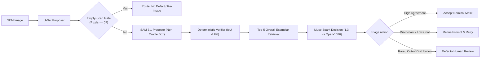

# SEM Triage Agent: Verifiable Multimodal Wafer Inspection & Selective Abstention

> A verifiable multimodal triage framework evaluating foundation vision (`sam-3.1`) and language models (`muse-spark-1.3` / `muse-spark-open-1026`) on semiconductor SEM defects from the Carinthia-S benchmark ([DOI: 10.5281/zenodo.16895427](https://doi.org/10.5281/zenodo.16895427)).

## Problem & Motivation
In semiconductor manufacturing, Automatic Defect Classification ([ADC](https://electronicimaging.spiedigitallibrary.org/conference-proceedings-of-spie/10145/1014523/Scanning-electron-microscope-automatic-defect-classification-of-process-induced-defects/10.1117/12.2258122.full)) systems like [Applied Materials SEMVision](https://www.appliedmaterials.com/eu/en/product-library/g7-semvision-defect-analysis.html) face extreme class imbalance: nominal patterns dominate (>93%), while rare yield-killing anomalies represent under 1.5% of wafer scans. U-Net detectors degrade on rare morphology (~0.66 median IoU), but hallucinating defects on empty tool-misalignment scans triggers costly false fab stops. Following selective risk control ([SafeRestore, arXiv:2609.03475](https://arxiv.org/abs/2609.03475)), this agent automatically segments nominal defects, flags rare anomalies for expert human triage, and routes empty scans to re-imaging without hallucinated masks.

## Status

| Milestone / Capability | Status | Evidence / Artifact |
| :--- | :---: | :--- |
| **Gate 0: SAM 3.1 Zero-Shot Probing & Decoder** | **DONE** | 80 live API calls on real endpoints; bit-exact decoder; `results/gate0/` |
| **Gate 0 Forensics: Jitter & Corner Artifacts** | **DONE** | 68 live calls; 4 of 6 corner failures rescued; `results/gate0/` |
| **Gate 1: Zero-Leakage Dataset Split (8 Splits)** | **DONE** | 4,591 samples verified; `rare_dev` (17) vs `rare_eval_test` (50); `results/gate1/` |
| **Gate 1: ResNet18 U-Net Baseline** | **DONE** | 15 epochs on local RTX 4050 (105.6s); non-oracle boxes exported; `results/gate1/` |
| **Sharpened 10-Sample Mechanism Verification** | **IN PROGRESS** | Protocol & manifest pre-registered (seed 42); tag `sharpened-test-frozen` |
| **Multimodal Agent Triage & Open-Weights Ablations** | **PLANNED** | Hosted inference on Modal/Baseten for `meta-models/muse-spark-open-1026` |

## Pipeline Architecture



## Empirical Benchmark Results (Generated from Tracked JSON)

### Gate 0: SAM 3.1 Zero-Shot Benchmark (20 Images, Oracle BBoxes)
| Arm | Scored | Mean IoU | Median IoU | Nominal (3,4,6) Median IoU | Rare (1,2,5) Median IoU | Mean Dice |
| :--- | :---: | :---: | :---: | :---: | :---: | :---: |
| `text_full` | 0 / 20 | N/A | N/A | N/A | N/A | N/A |
| `box_full` | 20 / 20 | 0.6374 | 0.8572 | 0.8642 | 0.3947 | 0.6881 |
| `crop_roi` | 0 / 20 | N/A | N/A | N/A | N/A | N/A |
| `crop_clahe` | 0 / 20 | N/A | N/A | N/A | N/A | N/A |

### Gate 1: U-Net Baseline Empirical Multi-Split Evaluation (Unseen Splits)
| Split / Cohort | Images (n) | Primary Median IoU (>=128) | Primary Mean IoU | Secondary Median IoU (>0) | Mean Dice |
| :--- | :---: | :---: | :---: | :---: | :---: |
| **Nominal Test (Overall)** | 430 | **0.8869** | 0.8536 | 0.8869 | 0.9170 |
| - `class_3` | 401 | 0.8843 | 0.8482 | 0.8843 | 0.9137 |
| - `class_4` | 29 | 0.9418 | 0.9278 | 0.9418 | 0.9621 |
| **Rare Holdout (Overall)** | 67 | **0.6583** | 0.5981 | 0.6595 | 0.7237 |
| - `class_1` | 55 | 0.6315 | 0.5776 | 0.6283 | 0.7050 |
| - `class_2` | 8 | 0.6046 | 0.6125 | 0.6455 | 0.7553 |
| - `class_5` | 4 | 0.8532 | 0.8508 | 0.8532 | 0.9179 |
| **Class 6 Test (Empty Scans)** | 23 | Raw Spec: **47.83%** (11/23) | Filtered (>=16px) Spec: **82.61% (19/23)** | Mean FP: 6.7 px | Max FP: 37 px |

## Limitations
- **Single Layer & Unstructured:** Evaluated on a single production layer of unstructured semiconductor wafers.
- **Pixel Units Only:** No physical metrology scale ($\text{nm}$/$\mu\text{m}$) is available in the public dataset.
- **Oracle Upper Bounds:** Gate 0 SAM results reflect oracle bounding boxes; end-to-end performance depends on U-Net detection.
- **Rare Defect Baseline:** U-Net segments rare defects at ~0.66 median IoU; the agent's goal is selective triage and bad-mask abstention, not raw detection.
- **Prevalence Gap:** Rare defects occur at ~1.5% natural prevalence in fabs; evaluations report both enriched test and calibrated natural metrics.
- **Existing Art:** Commercial rule-based ADC systems already operate in production fabs; this work evaluates multimodal foundation models with abstention.

## Quickstart (6 Tested Commands)
```bash
git clone https://github.com/sem-triage/sem-triage-agent.git && cd sem-triage-agent
python -m venv .venv && source .venv/bin/activate  # Windows: .venv\Scripts\activate
pip install -r requirements.txt
pytest -v
python scripts/make_results_table.py --print
python scripts/select_sharpened_test_samples.py
```

## Documentation & Compliance Links
- `docs/PROBLEM_AND_APPROACH.md`: Semiconductor triage background, abstention, and hypotheses H1-H3.
- `docs/COMPUTE_PLAN.md`: Measured local compute benchmarks (zero training credits needed) and hosted inference plan for `muse-spark-open-1026`.
- `docs/HACKATHON_COMPLIANCE.md`: Rules compliance, component lineage, CC BY 4.0 rights.
- `docs/sharpened_test_protocol.md`: Pre-registered frozen mechanism verification protocol.

## Data Attribution & License
- **Dataset:** Carinthia-S ([DOI: 10.5281/zenodo.16895427](https://doi.org/10.5281/zenodo.16895427)), by Corinna Kofler (KAI GmbH), Vahidin Hasić (University of Sarajevo), et al., licensed under [CC BY 4.0](https://creativecommons.org/licenses/by/4.0/). Original Carinthia benchmark: [DOI: 10.5281/zenodo.10715190](https://doi.org/10.5281/zenodo.10715190).
- **Code License:** [MIT License](LICENSE).
