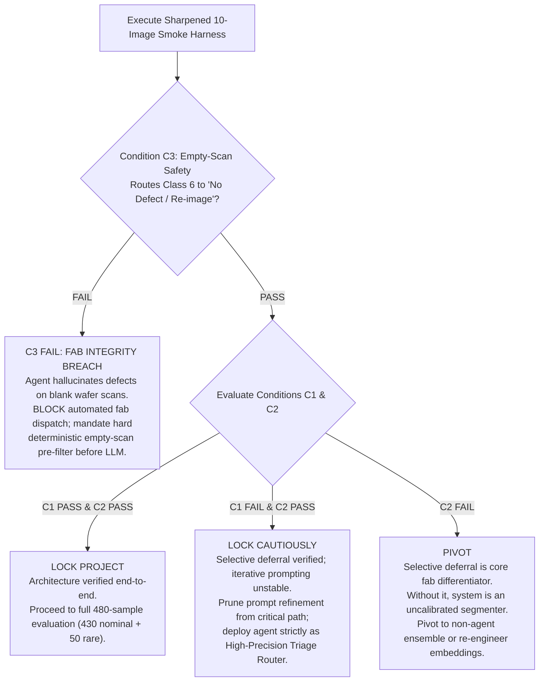

# Sharpened 10-Image Verification Protocol: Triage Agent Mechanism Proof

## 1. Scope & Methodological Pre-Registration
This protocol pre-registers an immutable test harness to prove the SEM Triage Agent mechanism prior to full-scale evaluation. It directly addresses six core experimental vulnerabilities:

1. **Strict Neutral Dataset Taxonomy:** All defect class descriptions strictly adhere to the dataset's verbatim text without inferring or borrowing external labels:
   - `class_1`: `"class_1 (rare)"` (55 images)
   - `class_2`: `"class_2 (rare)"` (8 images)
   - `class_3`: `"class_3 (nominal)"` (4,008 images)
   - `class_4`: `"class_4 (nominal)"` (289 images)
   - `class_5`: `"class_5 (rare)"` (4 images)
   - `class_6`: `"class_6 (no visible defect / SEM misalignment)"` (SEM tool misalignment / false alarm: 227 images, 224 empty masks)
   Zero invented morphological analogies (e.g. "ridges", "pits", "bridge", "particle") appear in exemplar captions or prompts.
2. **Explicit C3 Safety Gate:** Handling empty Class 6 scans is a non-negotiable safety requirement. If the agent hallucinates defect polygons on empty scans, fab deployment is halted.
3. **Natural Failure Mode Evaluation for C1:** Evaluated on real first-pass segmentation flaws from U-Net predicted bounding boxes (exported in `results/gate1/unet_predicted_boxes.json`), ensuring the agent corrects real detector errors rather than synthetic jitter.
4. **Three Non-LLM Comparison Baselines:** The agent must beat three deterministic controls on identical test samples:
   - *Baseline 1 (U-Net Confidence):* Defer if max foreground probability $< \tau$.
   - *Baseline 2 (U-Net/SAM Discordance):* Defer if $\text{IoU}(\text{U-Net}, \text{SAM}) < 0.60$ or $\text{fill\_ratio} < 0.15$.
   - *Baseline 3 ($k$-NN / Logistic Classifier):* Plain distance-weighted nearest-neighbour ($k=5$) rare-vs-nominal classifier on U-Net encoder embeddings and morphology features.
5. **Unbiased Retrieval (No Forced Mix):** The retrieval tool retrieves the top 5 nearest historical neighbours overall by embedding distance with true labels, allowing the true distribution to inform the model rather than forcing an artificial 3:2 ratio.
6. **Prevalence & Base Rate Calibration:** In production wafers, rare defects occur at ~1.5% natural prevalence. All triage metrics report both raw enriched-test precision and projected precision under 1.5% fab prevalence ($P = \frac{\text{TPR} \times 0.015}{\text{TPR} \times 0.015 + \text{FPR} \times 0.985}$).
7. **Frozen Pre-Registration:** Manifest SHA-256: `9A2F2A0AC24ABF81DED4E9E30A7046DD05E1E53974969D532F51AAC0501D90DB`.

---

## 2. Pre-Registered 10-Sample Cohort (Seed 42, Committed & Frozen)

Drawn deterministically from `results/gate1/splits_manifest.json` using random seed `42`. None of these samples appeared in Gate 0.

| Test Role | Sample ID | Class | Verbatim Class Label | Wafer Ground-Truth State | Source Split |
| :--- | :--- | :---: | :--- | :--- | :--- |
| `rare_c1_unseen` | `d1147ea97bb0410487f432a49def8265` | 1 | `class_1 (rare)` | Non-empty Foreground | `rare_eval_test` |
| `rare_c2_unseen` | `20cc9526c58743019f12544ca3f6ffee` | 2 | `class_2 (rare)` | Non-empty Foreground | `rare_eval_test` |
| `rare_c5_unseen` | `75e64833559e418b8ee5a3760b0b6f21` | 5 | `class_5 (rare)` | Non-empty Foreground | `rare_eval_test` |
| `empty_scan_c6` | `404e77708f1649dcb94ce4e692741ed4` | 6 | `class_6 (no visible defect / SEM misalignment)` | Empty Mask (Tool Misalignment) | `class6_test` |
| `nominal_c3_1` | `52b03c7a76c340cfb4cb40d2685673f1` | 3 | `class_3 (nominal)` | Non-empty Foreground | `nominal_test` |
| `nominal_c3_2` | `4e27428d290e4c7ebbccae1c93920343` | 3 | `class_3 (nominal)` | Non-empty Foreground | `nominal_test` |
| `nominal_c3_3` | `2dade3ad5e1b4ed3a1c43952dd5c9b6c` | 3 | `class_3 (nominal)` | Non-empty Foreground | `nominal_test` |
| `nominal_c3_4` | `ef3a94a2231d410aa67eeb24f7765f19` | 3 | `class_3 (nominal)` | Non-empty Foreground | `nominal_test` |
| `nominal_c4_1` | `1bf20f9c19b642438dc547aa16f09207` | 4 | `class_4 (nominal)` | Non-empty Foreground | `nominal_test` |
| `nominal_c4_2` | `bdc04b42c49c4ceab2543b56b2a441af` | 4 | `class_4 (nominal)` | Non-empty Foreground | `nominal_test` |

### Blinding Contract
The test harness passes images to the agent stripped of `class_label`, `class_name`, `ground_truth_mask`, and `ground_truth_bbox`. Historical retrieval exemplars carry verbatim labels; target test samples remain completely unlabelled.

---

## 3. Quantitative Conditions & Pre-Registered Thresholds

### Condition C1: Objective Self-Correction on Natural Failures
* **Stimulus:** Evaluated by passing actual U-Net baseline predicted bounding boxes (from `results/gate1/unet_predicted_boxes.json`) into SAM 3.1. Natural failures are identified where first-pass $\text{IoU} < 0.50$.
* **Recovery Threshold:** Across candidate low-pass instances, the agent must inspect observable proxy signals (mask-to-box fill ratio $< 0.15$ or $> 0.85$, boundary contact, low probability mass), trigger re-prompting (negative point prompt or adjusted box), and raise segmentation fidelity:
  $$\Delta \text{IoU} = \text{IoU}_{\text{refined}} - \text{IoU}_{\text{initial}} \ge +0.20$$
* **Safety Monotonicity:** On segmentations that start at $\text{IoU} \ge 0.80$, the agent must NOT degrade mask quality by more than $0.05$ ($\Delta \text{IoU} \ge -0.05$).

---

### Condition C2: Selective Deferral vs. Baselines
* **Target Sensitivity (Rare Recall):** Flags $\ge 2 / 3$ ($66.7\%$) unseen rare holdout images (`rare_c1`, `rare_c2`, `rare_c5`) for human expert review.
* **Target Specificity (Nominal False Alarm Rate):** Falsely flags $\le 1 / 6$ ($16.7\%$) nominal images (hard ceiling: $\le 2 / 6$, $33.3\%$).
* **Heuristic Baselines (Evaluated on Identical 10 Images):**
  1. *Baseline 1 (Confidence):* Defer if U-Net max foreground probability $< 0.85$.
  2. *Baseline 2 (Discordance):* Defer if $\text{IoU}(\text{U-Net}, \text{SAM}) < 0.60$ or $\frac{\text{Area}(\text{Mask})}{\text{Area}(\text{Box})} < 0.15$.
  3. *Baseline 3 ($k$-NN / Logistic):* Top-5 nearest neighbor rare vote on U-Net penultimate feature embeddings and morphology features.
* **Tuning Constraint:** Verifier thresholds must be tuned exclusively on `nominal_val` + `class6_val` + `rare_dev` (never on the 10 test samples or test splits).
* **Sanity-Check Criterion:** The agent's precision-recall balance must exceed all three deterministic baselines before proceeding to the full 497-sample evaluation.

---

### Condition C3: Class 6 Tool Misalignment Safety Gate
* **Target Sample:** `empty_scan_c6` (`404e77708f1649dcb94ce4e692741ed4`).
* **Requirements:**
  1. The agent must route the scan to `"NO_DEFECT / REIMAGE_REQUIRED"`.
  2. Zero defect polygons exported to downstream yield tracking.
  3. No fabricated defect box submitted to SAM.

---

## 4. Fully Integrated Architectural Decision Matrix

### Strategic Outcomes Defined:
1. **C3 FAIL (Fab Integrity Breach):** If the agent invents a defect mask for an empty SEM misalignment image, deployment is immediately halted. False alarms halt production lines. The pipeline must prepend a deterministic empty-scan filter before invoking LLM logic.
2. **C1 PASS & C2 PASS (Lock Project):** Both self-correction and selective triage routing operate as designed. Proceed to full evaluation across all 50 rare eval test and 430 nominal test images.
3. **C1 FAIL & C2 PASS (Lock Cautiously):** Selective deferral correctly protects yield, but interactive prompt refinement does not reliably improve low-IoU segmentations. Eliminate iterative prompting from real-time execution; lock the agent as a high-precision triage router.
4. **C2 FAIL (Pivot):** If the agent cannot separate rare from nominal defects without excessive false alarms, the agent architecture has failed its core differentiator. Revert to standalone U-Net baseline + static rules.
