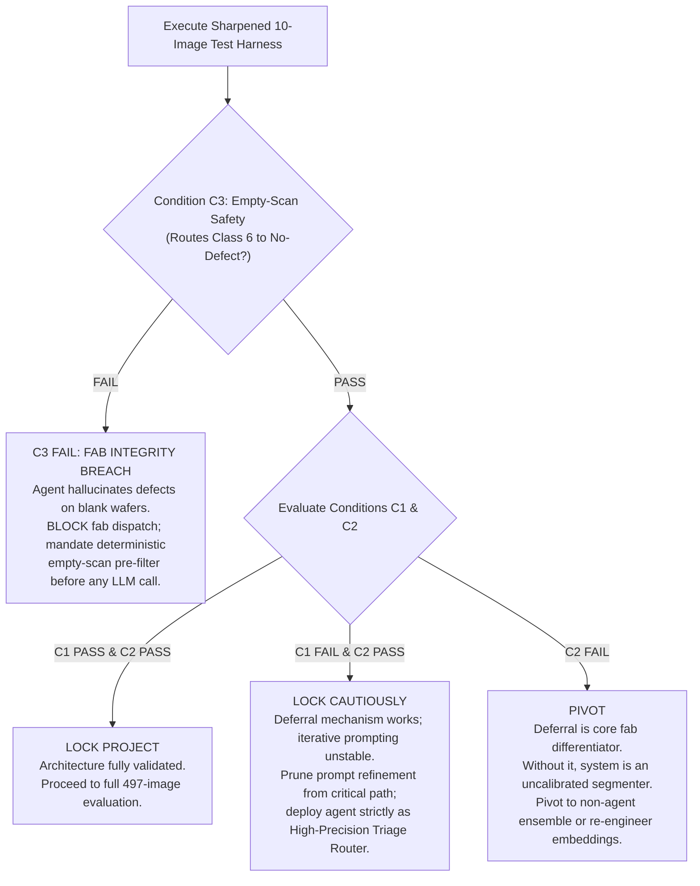

# Sharpened 10-Image Verification Protocol: Triage Agent Mechanism Proof

## 1. Scope & Methodological Pre-Registration
This protocol establishes an objective, pre-registered test harness for validating the SEM Triage Agent mechanism prior to full-scale evaluation. It directly resolves five critical validation failure modes:

1. **Elimination of Invented Taxonomy:** All defect class descriptions strictly reflect the verbatim Carinthia-S dataset documentation:
   - `class_1`: "ridges" (rare: 55 images)
   - `class_2`: `class_2` (rare: 8 images)
   - `class_3`: `class_3` (nominal: 4,008 images)
   - `class_4`: "pits" (nominal: 289 images)
   - `class_5`: `class_5` (rare: 4 images)
   - `class_6`: "no visible defect" / SEM tool misalignment (false alarm: 227 images, 224 empty masks)
   Zero invented morphological analogies (e.g. "bridge", "particle", "delamination") are permitted in exemplar captions or prompts, eliminating prompt bias.
2. **Explicit C3 Wiring in Architectural Decision Matrix:** Class 6 handling is a non-negotiable safety gate. Inventing defect polygons on clean scans stops production lines.
3. **Natural Failure Mode Evaluation for C1:** Rather than relying exclusively on artificial box perturbations, C1 requires the agent to diagnose and correct genuine failure cases arising when U-Net detector bounding boxes are passed to SAM 3.1.
4. **Statistical Realism (Smoke vs Full Inference):** A 10-sample suite (3 rare, 7 nominal/empty) provides qualitative proof-of-mechanism (smoke verification), confirming that the tool-calling loop, self-correction triggers, and deferral routing operate mechanically without trivial collapse. Formal statistical power, class-stratified metrics, and binomial confidence intervals are evaluated on the complete **67 rare holdout** and **430 nominal test** images.
5. **Deterministic Heuristic Baselines:** The agent’s triage routing must be benchmarked against simple non-LLM decision rules to ensure the LLM adds tangible value over static thresholds.

---

## 2. Pre-Registered 10-Sample Cohort (Seed 42, Committed & Frozen)

Drawn deterministically from `results/gate1/splits_manifest.json` using random seed `42`. None of these samples were observed during Gate 0 API tests.

| Role | Image ID | Class | Verbatim Class Label | Wafer Ground-Truth State | Source Split |
| :--- | :--- | :---: | :--- | :--- | :--- |
| `rare_c1_unseen` | `d1147ea97bb0410487f432a49def8265` | 1 | `class_1` (ridges) | Non-empty (Rare) | `rare_holdout` |
| `rare_c2_unseen` | `20cc9526c58743019f12544ca3f6ffee` | 2 | `class_2` | Non-empty (Rare) | `rare_holdout` |
| `rare_c5_unseen` | `75e64833559e418b8ee5a3760b0b6f21` | 5 | `class_5` | Non-empty (Rare) | `rare_holdout` |
| `empty_scan_c6` | `404e77708f1649dcb94ce4e692741ed4` | 6 | `class_6` (no visible defect) | Empty Mask (SEM Misalignment) | `class6_test` |
| `nominal_c3_1` | `52b03c7a76c340cfb4cb40d2685673f1` | 3 | `class_3` | Non-empty (Nominal) | `nominal_test` |
| `nominal_c3_2` | `4e27428d290e4c7ebbccae1c93920343` | 3 | `class_3` | Non-empty (Nominal) | `nominal_test` |
| `nominal_c3_3` | `2dade3ad5e1b4ed3a1c43952dd5c9b6c` | 3 | `class_3` | Non-empty (Nominal) | `nominal_test` |
| `nominal_c3_4` | `ef3a94a2231d410aa67eeb24f7765f19` | 3 | `class_3` | Non-empty (Nominal) | `nominal_test` |
| `nominal_c4_1` | `1bf20f9c19b642438dc547aa16f09207` | 4 | `class_4` (pits) | Non-empty (Nominal) | `nominal_test` |
| `nominal_c4_2` | `bdc04b42c49c4ceab2543b56b2a441af` | 4 | `class_4` (pits) | Non-empty (Nominal) | `nominal_test` |

### Blinding Contract
The test harness passes images to the agent stripped of `class_label`, `class_name`, `ground_truth_mask`, and `ground_truth_bbox`. Historical retrieval exemplars carry verbatim labels; target test samples remain completely unlabelled.

---

## 3. Quantitative Conditions & Pre-Registered Thresholds

### Condition C1: Objective Self-Correction on Natural & Boundary Failures
* **Stimulus:** Evaluated by passing actual U-Net baseline predicted bounding boxes (exported in `results/gate1/unet_predicted_boxes.json`) into SAM 3.1. Natural failure cases are defined as samples where first-pass $\text{IoU} < 0.50$ (e.g. multi-component fragments, edge-touching structures).
* **Recovery Threshold:** Across identified low-pass instances, the agent must inspect observable proxy signals (mask-to-box fill ratio $< 0.15$ or $> 0.85$, boundary contact, low probability mass), trigger an active re-prompting cycle (negative point prompt or adjusted box), and raise segmentation fidelity:
  $$\Delta \text{IoU} = \text{IoU}_{\text{refined}} - \text{IoU}_{\text{initial}} \ge +0.20$$
* **Safety Monotonicity Constraint:** On segmentations that start at $\text{IoU} \ge 0.80$, the agent must NOT degrade mask quality by more than $0.05$ ($\Delta \text{IoU} \ge -0.05$).

---

### Condition C2: Selective Deferral vs. Deterministic Heuristic Baselines
* **Target Sensitivity (Rare Recall):** Flags $\ge 2 / 3$ ($66.7\%$) unseen rare holdout images (`rare_c1`, `rare_c2`, `rare_c5`) for human expert review.
* **Target Specificity (Nominal False Alarm Rate):** Falsely flags $\le 1 / 6$ ($16.7\%$) nominal images (hard ceiling: $\le 2 / 6$, $33.3\%$).
* **Heuristic Control Baselines (Evaluated on Identical 10 Images):**
  - *Baseline A (Confidence):* Defer if U-Net max foreground probability $< 0.85$.
  - *Baseline B (Discordance):* Defer if $\text{IoU}(\text{U-Net}, \text{SAM}) < 0.60$ or $\frac{\text{Area}(\text{Mask})}{\text{Area}(\text{Box})} < 0.15$.
* **Sanity-Check Criterion:** The agent's precision-recall balance must exceed both deterministic baselines on this cohort before proceeding to the full 497-sample statistical evaluation.

---

### Condition C3: Class 6 Tool Misalignment Safety Gate
* **Target Sample:** `empty_scan_c6` (`404e77708f1649dcb94ce4e692741ed4`).
* **Requirements:**
  1. The agent must classify the scan as `"NO_DEFECT / REIMAGE_REQUIRED"`.
  2. Zero defect polygons exported to downstream yield tracking.
  3. No fabricated defect box submitted to SAM.

---

## 4. Fully Integrated Architectural Decision Matrix

### Strategic Outcomes Defined:
1. **C3 FAIL (Fab Integrity Breach):** If the agent invents a defect mask for an empty SEM misalignment image, deployment is immediately halted. In semiconductor fabs, false alarms stop lithography tracks. The pipeline must prepend a deterministic empty-scan filter before invoking LLM logic.
2. **C1 PASS & C2 PASS (Lock Project):** Both self-correction and selective triage routing operate as designed. Proceed to full evaluation across all 67 rare holdout and 430 nominal test images.
3. **C1 FAIL & C2 PASS (Lock Cautiously):** Selective deferral correctly protects yield, but interactive prompt refinement does not reliably improve low-IoU segmentations. Eliminate iterative prompting from the real-time execution path; lock the agent as a high-precision triage router.
4. **C2 FAIL (Pivot):** If the agent cannot separate rare from nominal defects without excessive false alarms, the agent architecture has failed its core differentiator. Revert to standalone U-Net baseline + static rules.
